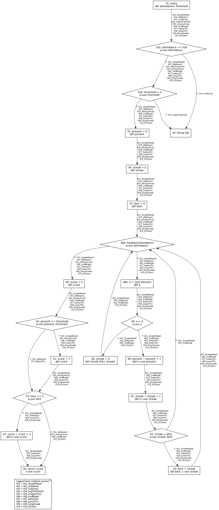

# lab10-dataflow

## Оюутны мэдээлэл

- Нэр: **Д.Нурсолтан**
- Оюутны код: **B232270039**

## Хөгжүүлэлтийн орчин

`java -version` гаралт:

```text
openjdk version "21.0.12.1" 2026-08-18
OpenJDK Runtime Environment (build 21.0.12.1+1-1-deb13u1)
OpenJDK 64-Bit Server VM (build 21.0.12.1+1-1-deb13u1, mixed mode, sharing)
```

`mvn -version` гаралт:

```text
Apache Maven 3.9.9
Maven home: /usr/share/maven
Java version: 21.0.12.1, vendor: Debian, runtime: /usr/lib/jvm/java-21-openjdk-amd64
Default locale: en, platform encoding: UTF-8
OS name: "linux", version: "6.12.113+deb13-amd64", arch: "amd64", family: "unix"
```
# Лаб 10 — Өгөгдлийн урсгалын тест

## Хэсэг A: gcd — DU хосын хүснэгт

Мөрийн дугаар (`DataFlowTargets.java`):

| Мөр | Код |
|-----|-----|
| 13 | `public static int gcd(int x, int y)` — x, y параметрийн def |
| 14 | `int tmp;` — зөвхөн зарлага, def биш |
| 15 | `while (y != 0)` — y-ийн p-use (T/F салаа) |
| 16 | `tmp = x % y;` — x, y c-use; tmp def |
| 17 | `x = y;` — y c-use; x def |
| 18 | `y = tmp;` — tmp c-use; y def |
| 20 | `return x;` — x c-use |

p-use-г while-ийн үнэн (T) / худал (F) салаагаар тусад нь тооцсон.
Хос бүр def-clear замтай, өөрөөр хэлбэл замын дунд тухайн хувьсагч дахин тодорхойлогдохгүй.

| ID  | Хувьсагч | Def мөр | Use мөр | c-use/p-use | Def-clear зам | Тестийн ID | Хамрагдсан |
|-----|----------|---------|---------|-------------|---------------|------------|-----------|
| P1  | x   | 13 | 16     | c-use | 13→14→15(T)→16 | T1, T3 | Тийм |
| P2  | x   | 13 | 20     | c-use | 13→14→15(F)→20 (давталтгүй) | T2 | Тийм |
| P3  | x   | 17 | 16     | c-use | 17→18→15(T)→16 | T1 | Тийм |
| P4  | x   | 17 | 20     | c-use | 17→18→15(F)→20 | T1, T3 | Тийм |
| P5  | y   | 13 | 15 (T) | p-use | 13→14→15, T салаа | T1, T3 | Тийм |
| P6  | y   | 13 | 15 (F) | p-use | 13→14→15, F салаа | T2 | Тийм |
| P7  | y   | 13 | 16     | c-use | 13→14→15(T)→16 | T1, T3 | Тийм |
| P8  | y   | 13 | 17     | c-use | 13→14→15(T)→16→17 | T1, T3 | Тийм |
| P9  | y   | 18 | 15 (T) | p-use | 18→15, T салаа | T1 | Тийм |
| P10 | y   | 18 | 15 (F) | p-use | 18→15, F салаа | T1, T3 | Тийм |
| P11 | y   | 18 | 16     | c-use | 18→15(T)→16 | T1 | Тийм |
| P12 | y   | 18 | 17     | c-use | 18→15(T)→16→17 | T1 | Тийм |
| P13 | tmp | 16 | 18     | c-use | 16→17→18 | T1, T3 | Тийм |

Нийт: x — 4, y — 8, tmp — 1 → **13 DU хос**, бүгд хамрагдсан (100%).

Лекцид дутуу үлдсэн хосууд: x(17→16), x(17→20), y(18→16), y(18→17), y(18→15F), tmp(16→18).
`y`-ийн def 13 ба def 18 тус бүрийн use (15T, 15F, 16, 17) тусдаа хос гэдгийг анхаарна.

## Тестүүд

| ID | Оролт | Хүлээгдэх | Давталт | Хамарсан хос |
|----|-------|-----------|---------|--------------|
| T1 | gcd(12,8) | 4 | 2 | P1, P3, P4, P5, P7, P8, P9, P10, P11, P12, P13 (11 хос) |
| T2 | gcd(7,0)  | 7 | 0 | P2, P6 |
| T3 | gcd(0,5)  | 5 | 1 | P1, P4, P5, P7, P8, P10, P13 (нэмэлт, шинэ хос нэмэхгүй) |

T1 + T2 хоёр л all-DU-pairs-д хүрэхэд хангалттай. T3 нь 1 давталтын замыг тусад нь шалгадаг нэмэлт тест.

## Заавруудын хариулт

**gcd(7,0) ямар хосыг ганцаараа хамардаг вэ?**
P2 = x(13→20) ба P6 = y(13→15F). Давталтад нэг ч удаа орвол 17-д x, 18-д y дахин тодорхойлогдоно. Тиймээс 13-аас гарсан x, y-ийн def нь 20 эсвэл 15(F)-д def-clear замаар хүрч чадахгүй. Зөвхөн 0 давталттай тест (y == 0 эхнээсээ) эдгээрийг хамарна.

**gcd(12,8) хэдэн давталт хийдэг вэ?**
2 давталт: (x,y)=(12,8) → tmp=4 → (8,4) → tmp=0 → (4,0), дараа нь y==0 тул гарч 4-ийг буцаана.

**Аль хосууд давталт шаардах вэ?**

| Шаардлага | Хосууд | Шалтгаан |
|-----------|--------|----------|
| 0 давталт | P2, P6 | def 13 шууд 20 / 15F-д хүрэх ёстой |
| ≥ 1 давталт | P1, P4, P5, P7, P8, P10, P13 | use нь биед (16, 17, 18) эсвэл def нь биед байж гарахад л хангалттай |
| ≥ 2 давталт | P3, P9, P11, P12 | def нь биед (17 эсвэл 18) бөгөөд use нь ДАРААГИЙН давталтын 15T / 16 / 17 дээр байна |

Иймд gcd(12,8) (2 давталт) бүх 2-давталт шаардсан хосыг хамардаг. gcd(0,5) (1 давталт) эдгээрийг хамарч чадахгүй.

## Ажиллуулах

    mvn test

# Хэсэг C — Fault Seeding

## Мутацийн туршилтын үр дүн

| ID | Мутаци | Төрөл | Үр дүнгийн файл |
|---|---|---|---|
| M1 | streak = streak + 1 мөр устгасан | Missing update | results/mvn-test-M1.txt |
| M2 | best = streak → best = present | Wrong variable | results/mvn-test-M2.txt |
| M3 | int total = present + best нэмсэн | Dead definition | results/mvn-test-M3.txt |

## M1 — Missing update

streak-ийн шинэчлэлтийг устгаснаар хувьсагчийн утга зөв шинэчлэгдэхгүй болсон.
JUnit тестүүдийн бодит үр дүнг mvn-test-M1.txt файлаас шалгасан.

## M2 — Wrong variable

best хувьсагчид streak-ийн оронд present утгыг оноосон.
DU хосын хамралт нь хувьсагчийн утга зөв эсэхийг бүрэн батлахгүй.
Иймээс семантикийн алдааг илрүүлэх нэмэлт тест шаардлагатай.

## M3 — Dead definition

total хувьсагчийг зарлаж утга оноосон боловч ашиглаагүй.
Энэ нь програмын үр дүнд нөлөөлөхгүй тул JUnit тест заавал унагахгүй.
Static Analysis буюу SonarLint, IDE inspection зэрэг хэрэгслээр илрүүлнэ.

## Эцсийн шалгалт

Эх кодыг git restore ашиглан сэргээсэн.
Эцсийн тестийн гаралт: results/mvn-verify-final.txt
JaCoCo тайлан: results/jacoco-final.csv


---

## Хэсэг B: bonus — бүрэн анализ

Мөрийн дугаар нь `DataFlowTargets.java` файлын мөр. Давхар нөхцөлтэй 32-р мөрийг
**32a** (`attendance == null`) ба **32b** (`threshold < 0`), for-each-ийн 38-р мөрийг
**38a** (нөхцөл: `attendance`-д дараагийн элемент байгаа эсэх) ба **38b** (алхам:
дараагийн элементийг `a`-д онооно) гэж салгав. p-use бүрийн T/F салаа тусдаа DU хос.

### B1. CFG



Ирмэг бүрийн хажууд түүнийг дайрдаг тестийн метод нэрийг бүрэн бичсэн. Эх файл: `cfg-bonus.dot`.

### B2. Def / Use жагсаалт

```text
31   bonus(int[] attendance, int threshold)   // def: attendance, threshold
32a  if (attendance == null                   // p-use: attendance
32b      || threshold < 0)                    // p-use: threshold
33     throw new IllegalArgumentException     //
35   int present = 0;                         // def: present
36   int streak  = 0;                         // def: streak
37   int best    = 0;                         // def: best
38a  for (int a : attendance)  [нөхцөл]       // p-use: attendance (hasNext)
38b                           [алхам]         // def: a
39   if (a > 0)                               // p-use: a
40     present = present + 1;                 // c-use: present;  def: present
41     streak = streak + 1;                   // c-use: streak;   def: streak
42     if (streak > best)                     // p-use: streak, best
43       best = streak;                       // c-use: streak;   def: best
46   else streak = 0;                         // def: streak   (KILL: streak)
49   int score = 0;                           // def: score
50   if (present >= threshold)                // p-use: present, threshold
51     score = 5;                             // def: score
53   if (best >= 5)                           // p-use: best
54     score = score + 3;                     // c-use: score;    def: score
56   return score;                            // c-use: score
```

Def-үүд (нийт 13): attendance@31, threshold@31, present@35, present@40, streak@36,
streak@41, streak@46, best@37, best@43, a@38b, score@49, score@51, score@54.

### B3. DU хосуудын хүснэгт (D1–D35)

| ID | Хувьсагч | Def | Use | Төрөл | Def-clear зам | Тест | Хамрагдсан |
|----|----------|-----|-----|-------|---------------|------|------------|
| D1 | attendance | 31 | 32a | p-use (T) | 31→32a→33 | t03 | ✔ |
| D2 | attendance | 31 | 32a | p-use (F) | 31→32a→32b | t01, t02, t04, t05, t06, t07, t08, t09, t10 | ✔ |
| D3 | attendance | 31 | 38a | p-use (T) | 31→32a→32b→35→36→37→38a→38b | t01, t02, t06, t07, t08, t09, t10 | ✔ |
| D4 | attendance | 31 | 38a | p-use (F) | 31→32a→32b→35→36→37→38a→49 | t01, t02, t05, t06, t07, t08, t09, t10 | ✔ |
| D5 | threshold | 31 | 32b | p-use (T) | 31→32a→32b→33 | t04 | ✔ |
| D6 | threshold | 31 | 32b | p-use (F) | 31→32a→32b→35 | t01, t02, t05, t06, t07, t08, t09, t10 | ✔ |
| D7 | threshold | 31 | 50 | p-use (T) | 31→32a→32b→35→36→37→38a→49→50→51 | t01, t05, t06, t08, t09, t10 | ✔ |
| D8 | threshold | 31 | 50 | p-use (F) | 31→32a→32b→35→36→37→38a→49→50→53 | t02, t07 | ✔ |
| D9 | present | 35 | 40 | c-use | 35→36→37→38a→38b→39→40 | t01, t06, t07, t08, t09, t10 | ✔ |
| D10 | present | 35 | 50 | p-use (T) | 35→36→37→38a→49→50→51 | t05 | ✔ |
| D11 | present | 35 | 50 | p-use (F) | 35→36→37→38a→49→50→53 | t02 | ✔ |
| D12 | present | 40 | 40 | c-use | 40→41→42→38a→38b→39→40 | t01, t06, t07, t08, t09 | ✔ |
| D13 | present | 40 | 50 | p-use (T) | 40→41→42→38a→49→50→51 | t01, t06, t08, t09, t10 | ✔ |
| D14 | present | 40 | 50 | p-use (F) | 40→41→42→38a→49→50→53 | t07 | ✔ |
| D15 | streak | 36 | 41 | c-use | 36→37→38a→38b→39→40→41 | t01, t06, t07, t08, t09 | ✔ |
| D16 | streak | 41 | 41 | c-use | 41→42→38a→38b→39→40→41 | t01, t06, t07, t08, t09 | ✔ |
| D17 | streak | 41 | 42 | p-use (T) | 41→42→43 | t01, t06, t07, t08, t09, t10 | ✔ |
| D18 | streak | 41 | 42 | p-use (F) | 41→42→38a | t01, t06 | ✔ |
| D19 | streak | 41 | 43 | c-use | 41→42→43 | t01, t06, t07, t08, t09, t10 | ✔ |
| D20 | streak | 46 | 41 | c-use | 46→38a→38b→39→40→41 | t01, t06, t10 | ✔ |
| D21 | best | 37 | 42 | p-use (T) | 37→38a→38b→39→40→41→42→43 | t01, t06, t07, t08, t09, t10 | ✔ |
| D22 | best | 37 | 42 | p-use (F) | — (биелэшгүй) | — | ✘ биелэшгүй |
| D23 | best | 37 | 53 | p-use (T) | — (биелэшгүй) | — | ✘ биелэшгүй |
| D24 | best | 37 | 53 | p-use (F) | 37→38a→49→50→53→56 | t02, t05 | ✔ |
| D25 | best | 43 | 42 | p-use (T) | 43→38a→38b→39→40→41→42→43 | t01, t06, t07, t08, t09 | ✔ |
| D26 | best | 43 | 42 | p-use (F) | 43→38a→38b→39→40→41→42→38a | t01, t06 | ✔ |
| D27 | best | 43 | 53 | p-use (T) | 43→38a→49→50→53→54 | t01, t07, t08, t09 | ✔ |
| D28 | best | 43 | 53 | p-use (F) | 43→38a→49→50→53→56 | t06, t10 | ✔ |
| D29 | a | 38b | 39 | p-use (T) | 38b→39→40 | t01, t06, t07, t08, t09, t10 | ✔ |
| D30 | a | 38b | 39 | p-use (F) | 38b→39→46 | t01, t02, t06, t10 | ✔ |
| D31 | score | 49 | 54 | c-use | 49→50→53→54 | t07 | ✔ |
| D32 | score | 49 | 56 | c-use | 49→50→53→56 | t02 | ✔ |
| D33 | score | 51 | 54 | c-use | 51→53→54 | t01, t08, t09 | ✔ |
| D34 | score | 51 | 56 | c-use | 51→53→56 | t05, t06, t10 | ✔ |
| D35 | score | 54 | 56 | c-use | 54→56 | t01, t07, t08, t09 | ✔ |

Нийт 35 хос = 33 боломжтой (бүгд хамрагдсан) + 2 биелэшгүй (D22, D23).
Тест ID: t01 = `t01_streakReset`, t02 = `t02_allAbsent`, t03 = `t03_nullArray`,
t04 = `t04_negThreshold`, t05 = `t05_emptyArray`, t06 = `t06_midBreak`,
t07 = `t07_belowThr`, t08 = `t08_exactThr`, t09 = `t09_longStreak`, t10 = `t10_thrZero`.

#### Kill (дахин тодорхойлолт)

`else` доторх `streak = 0` (мөр 46) нь амьд байгаа **streak@36** ба **streak@41**-ийг
алдна (kill). Үүнтэй төстэй: streak@41 нь streak@36 болон streak@46-г, best@43 нь best@37-г,
present@40 нь present@35-ыг, score@51 нь score@49-ийг, score@54 нь score@49 ба score@51-ийг алдна.

**Kill-ээр def-clear замгүй болох тул DU хос гэж ТООЦООГҮЙ хослолууд:**

- **streak 36 → 42 ба 36 → 43:** 42, 43-д хүрэхийн өмнө заавал 41 (`streak + 1`) дайрдаг тул def 36 алдагдана.
- **streak 46 → 42 ба 46 → 43:** 46-аас 42-д хүрэх бүх зам 41-ийг дайрдаг тул def 46 алдагдана.

Харин **streak 36 → 41** ба **41 → 41** нь `else` (мөр 46)-ээр дамжсан замд алдагддаг ч
`else`-гүй өөр def-clear зам байгаа тул (D15, D16) DU хос мөн. D20 (46 → 41) нь зөвхөн
тасалсан өдрийн дараа ирсэн өдөр л биелнэ.

#### Биелэшгүй хосууд

- **D22 (best 37→42, p-F):** best = 0 хэвээр (37-ын def амьд) байх нь 42-т анх хүрэх үед л, тэр үед
  streak ≥ 1 (41-д нэмэгдсэн) тул `streak > best` үргэлж үнэн; хэрэв худал байх гэвэл өмнө нь 43 ажиллаж best-ийг дарна.
- **D23 (best 37→53, p-T):** 37-ын def амьд = 43 хэзээ ч ажиллаагүй = best 0 хэвээр, тэгвэл `best >= 5` үнэн байж чадахгүй.

### B4. Тестүүд хоёр шатаар

**Шат 1 — ALL-DEFS: хамгийн цөөн нь 2 тест.**
13 def бүр дор хаяж нэг use-д хүрэх ёстой. **score@49** нь зөвхөн `present < threshold`
үед use-д хүрнэ (эс бөгөөс 51 түүнийг дарж бичнэ), харин **score@51** нь зөвхөн
`present >= threshold` үед use-д хүрнэ. Энэ хоёр нөхцөл нэг гүйцэтгэлд хамт биелэх
боломжгүй тул 1 тест хүрэлцэхгүй, 2 тест хангалттай:

| Тест | Оролт | Хүлээгдэх | Хамарсан def |
|------|-------|-----------|--------------|
| t01_streakReset | `[1,1,1,1,1,0,1]`, 3 | 8 | бусад бүх def (score@51, score@54, streak@46 гэх мэт) |
| t02_allAbsent | `[0,0,0]`, 1 | 0 | score@49 (49→56) |

**Шат 2 — ALL-DU-PAIRS:** t03–t10 нэмж 33 боломжтой хос бүрийг хамруулсан (хүснэгтийн "Тест" багана).

### B5. JaCoCo

| Үе | Branch (covered/total) | BRANCH_MISSED | Line (covered/total) | LINE_MISSED |
|----|------------------------|---------------|----------------------|-------------|
| jacoco-alldefs.csv (t01, t02 + GcdTest) | 14/16 | 2 | 22/24 | 2 |
| jacoco-final.csv (бүх тест) | 16/16 | 0 | 23/24 | 1 |

- **alldefs:** BRANCH_MISSED = 2 — 32a ба 32b-ийн T (throw) салаа. ALL-DEFS хангагдсан ч
  Branch 100% биш: ALL-DEFS нь def бүрийг ямар нэг use-д хүргэхийг л шаарддаг (D2, D6 хангалттай)
  тул use-ийн T салаа заавал дайрагдахгүй. LINE_MISSED = 2: 33-р мөр (throw) ба 7-р мөр.
- **final:** BRANCH_MISSED = 0 (16/16). LINE_MISSED = 1 нь 7-р мөр (Java-гийн далд constructor),
  `new DataFlowTargets()` тест бичих, кодыг өөрчлөх шаардлагагүй.

**Branch 100% болсон мөчид DU хос үлдэж болох уу? — Болно.** Жишээ: зөвхөн t01–t04-ийг
ажиллуулахад JaCoCo Branch **16/16 (BRANCH_MISSED = 0)** гарсан ч DU хүснэгтийн **5 боломжтой хос
хамрагдаагүй**: D10 (present 35→50 T), D14 (present 40→50 F), D28 (best 43→53 F),
D31 (score 49→54), D34 (score 51→56). Яагаад: бүх салаа дайрагдсан ч тэдгээрийн хооронд
def-ээс use рүү хүрэх тодорхой хослолууд (жишээ нь `present < threshold` байхад урт цуваа:
49→54) нэг ч удаа ажиллаагүй. Иймд Branch хамралт DU хамралтыг **хэмждэггүй**, DU хүснэгт
нь тусдаа нотолгоо.
